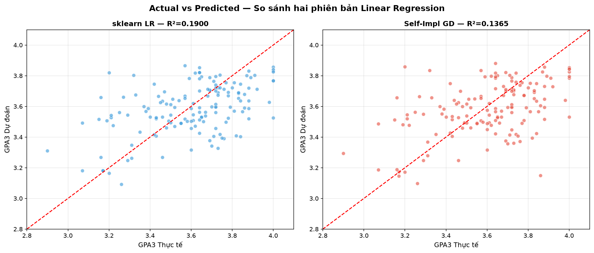
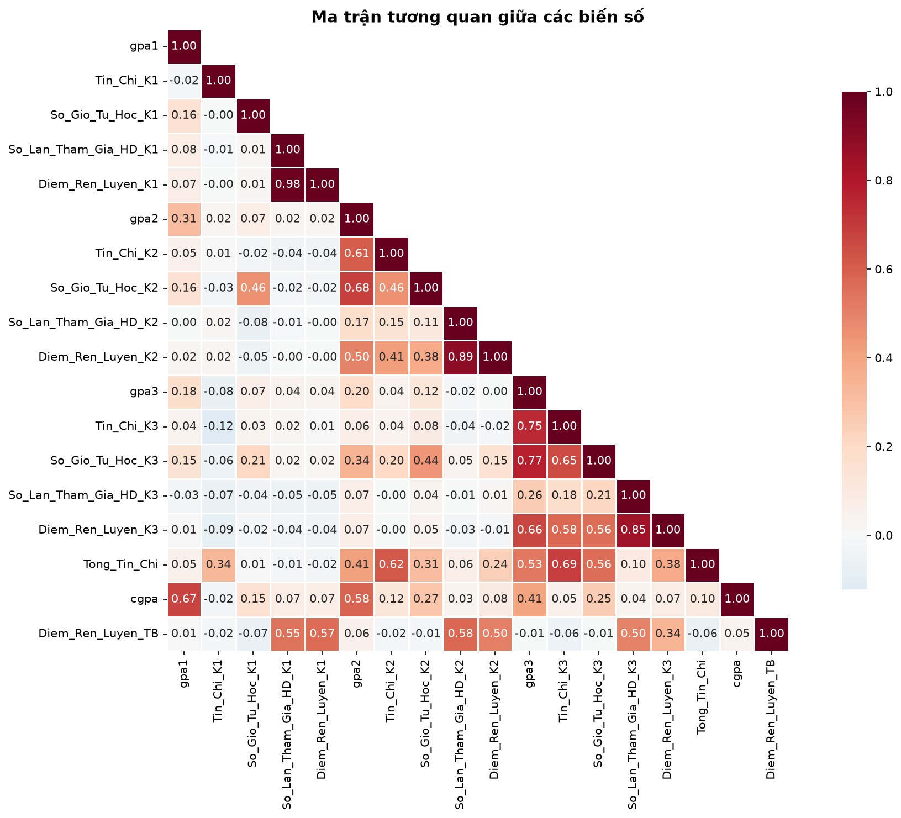
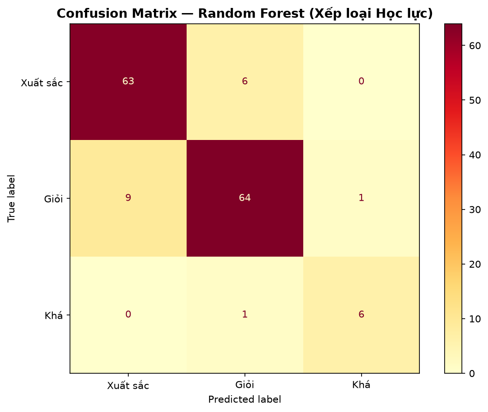
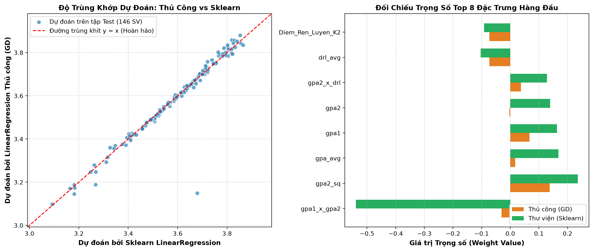

# 🎓 Student Performance Prediction & Academic Early Warning System

<p align="center">
  
  
  
  
  
</p>

<p align="center">
  A machine learning pipeline and interactive web platform for forecasting Semester 3 academic outcomes ($GPA_3$) and identifying early student dropout risks, engineered by <strong>Đặng Đại Lợi (<a href="https://github.com/ddloi">@ddloi</a>)</strong>.
</p>

---

## 📌 Executive Summary

Predicting student academic progression and retention is a cornerstone challenge in higher education analytics. This system builds a multi-dimensional student feature store (Academic Performance, Learning Behaviors, Credits Completed, Discipline Scores) to:
1. **Predict Semester 3 GPA ($GPA_3$)** using self-implemented Gradient Descent & OLS Linear Regression.
2. **Estimate Academic Rank** (Xuất sắc, Giỏi, Khá, Trung bình) and compare predictions with stored test records.
3. **Trigger Early Academic Warnings** for students at risk of probation or dropout after Semester 2.
4. **Validate Dataset Consistency** with 12 checks for structure, semester states, formulas, and a declared feature list. These checks alone do not establish that the full training pipeline is free of data leakage.

---

## 📊 Scientific Figures & Analytical Showcase

### 1. Actual vs. Predicted GPA Comparison
<p align="center">
  
  <br/>
  <em>Figure 1: Actual and predicted Semester 3 GPA. Stored OLS test results: $R^2 = 0.1900$, $\text{MAE} = 0.1651$; see reports/model_training_results.md.</em>
</p>

### 2. Multi-Dimensional Correlation Matrix
<p align="center">
  
  <br/>
  <em>Figure 2: Heatmap matrix illustrating correlation between study hours, attendance, prior semester GPAs, and Semester 3 performance.</em>
</p>

### 3. Classification Confusion Matrix & Loss Convergence
<div align="center">
  <table>
    <tr>
      <td align="center"><strong>Academic Rank Classification</strong></td>
      <td align="center"><strong>Scratch GD Loss Convergence</strong></td>
    </tr>
    <tr>
      <td></td>
      <td></td>
    </tr>
  </table>
</div>

---

## 🔬 Experimental Results & Benchmark

### 1. General Performance Overview

Stored regression results from [reports/model_training_results.md](reports/model_training_results.md):

| Metric | Scikit-Learn OLS | Scratch Gradient Descent |
| :--- | :---: | :---: |
| **Mean Absolute Error (MAE)** | **0.1651** | **0.1676** |
| **Mean Absolute Percentage Error (MAPE)** | **4.63%** | **4.69%** |
| **$R^2$ Test Score** | **0.1900** | **0.1365** |

The current [artifacts/predictions/bang_so_sanh_du_doan.csv](artifacts/predictions/bang_so_sanh_du_doan.csv) contains **136/146 correct rank comparisons (93.15%)**, with mean GPA error **0.166**. These are CSV comparison results, separate from the regression metrics above and the older report's 134/146 result. The dashboard reads this CSV for its validation table; model-summary metrics are stored values. Live predictions use `artifacts/models/trained_models.joblib`, which is not re-evaluated automatically when the page loads.

### 2. ⚖️ Linear Regression: Self-Implemented (Scratch) vs. Scikit-Learn

To satisfy academic defense and rigorous algorithmic verification, the system provides a side-by-side comparison between **handcrafted implementations** and the industry-standard **Scikit-Learn** library:

<p align="center">
  
  <br/>
  <em>Figure 4: Scatter alignment between Scratch GD vs. Sklearn predictions (left) and top feature coefficient weights comparison (right).</em>
</p>

| Model Implementation | Mathematical Formulation | $R^2$ Train | $R^2$ Test | RMSE | MAE | MAPE (%) | Bias ($b$) | Fit Time |
| :--- | :--- | :---: | :---: | :---: | :---: | :---: | :---: | :---: |
| **1. Manual (Gradient Descent)** | Iterative GD: $w \leftarrow w - \alpha \frac{1}{n} X^T(\hat{y}-y)$ | 0.3693 | 0.1365 | 0.2147 | 0.1676 | 4.69% | 3.5493 | ~300 ms |
| **2. Manual (Normal Equation)** | Closed-Form OLS: $w = (X^T X)^{-1} X^T y$ | **0.3759** | **0.1900** | **0.2079** | **0.1651** | **4.63%** | **3.5493** | **~17 ms** |
| **3. Library (Scikit-Learn OLS)** | LAPACK / SVD Decomposition | **0.3759** | **0.1900** | **0.2079** | **0.1651** | **4.63%** | **3.5493** | ~84 ms |

> 💡 **Key Takeaways for Defense / Viva**:
> - **Numerical Comparison**: The displayed Normal Equation and Scikit-Learn metrics agree at the reported precision; this does not establish exact equality across all decimal places.
> - **Gradient Descent**: The stored 5,000-iteration GD result has RMSE 0.2147 versus OLS 0.2079 (difference approximately 0.0068).

---

## 🗂️ Project Structure

```text
student-performance-prediction/
├── student_performance/          # Application package
│   ├── api.py                   # HTTP routes and input validation
│   ├── engine.py                # Lazy cache loading and inference
│   ├── features.py              # Feature definitions and preparation
│   ├── models.py                # Scratch regression model
│   ├── paths.py                 # Paths anchored to the project root
│   └── cli.py                   # Local launcher; __main__.py enables -m
├── scripts/                     # Explicit dataset, experiment and report commands
│   ├── generate_dataset.py
│   ├── train_models.py
│   ├── compare_linear_regression.py
│   └── generate_report.py
├── tests/                       # Dataset, API and structure regression tests
├── data/
│   ├── raw/simul_combined_lab.csv
│   └── processed/student_dataset_500.csv
├── artifacts/
│   ├── models/trained_models.joblib
│   └── predictions/bang_so_sanh_du_doan.csv
├── reports/
│   ├── figures/                 # Saved research plots
│   ├── model_training_results.md
│   └── BaoCao_DoAn_HocMay.docx
├── static/                      # HTML, CSS, JavaScript and local Chart.js
├── docs/architecture.md         # Responsibilities and artifact lifecycle
├── app.py                       # Compatibility for uvicorn app:app
├── model_engine.py              # Compatibility for older saved model classes
├── run_app.py                   # Compatibility launcher
├── run_app.bat                  # Windows launcher
├── requirements.txt
├── requirements-dev.txt
└── PRODUCT.md                   # Product and UX context
```

`__init__.py` files make the application, scripts and tests importable packages. Local logs and scratch files belong in ignored `work/`; `.pipeline/` contains historical project review metadata. See [architecture and artifact lifecycle](docs/architecture.md) for ownership and update rules.

---

## 🚀 Run the Demo

Run these commands from the project root. Python 3.10 or later is required.

```bash
git clone https://github.com/ddloi/student-performance-prediction.git
cd student-performance-prediction
python -m pip install -r requirements.txt
python -m student_performance
```

On Windows, `run_app.bat` is also available. The launcher opens [http://127.0.0.1:8000](http://127.0.0.1:8000). Use `--port 8765 --no-browser` to select another port without opening a browser. The older `python run_app.py` launcher remains compatible.

To start only the server:

```bash
python -m uvicorn student_performance.api:app --host 127.0.0.1 --port 8000
```

The older `python -m uvicorn app:app` entry remains compatible. Filesystem paths are resolved from `student_performance.paths`, independently of the current working directory; Python still needs to be able to import the package when launching it.

Luồng chính: chọn mẫu hoặc nhập dữ liệu hai học kỳ → dự đoán kỳ 3 → xem so sánh mô hình. Trong tập kiểm chứng, tìm/lọc sinh viên rồi chọn **Thử** để nạp dữ liệu vào form. Trang báo cáo cung cấp file Word và CSV. Giao diện hỗ trợ bàn phím, màn hình nhỏ và sử dụng thư viện biểu đồ lưu nội bộ.

## 🧪 Validate the Project

```bash
python -m pip install -r requirements-dev.txt
python -m unittest discover -s tests -v
```

Run only the dataset checks or API tests:

```bash
python -m tests.test_dataset
python -m unittest tests.test_api -v
```

The dataset suite covers 12 consistency rules. The API suite checks inference, input validation, searches, pagination, downloads and zero-valued inputs. Tests verify functionality and selected data invariants; they do not establish that the full training pipeline is leakage-free or suitable for real student decisions. Use the test output for the current pass count.

## 🔬 Reproduce Data, Experiments and Reports

These commands can overwrite their corresponding generated files. Importing the script modules does not run their workflows.

| Command | Input | Generated output |
| :--- | :--- | :--- |
| `python -m scripts.generate_dataset` | `data/raw/simul_combined_lab.csv` | `data/processed/student_dataset_500.csv` |
| `python -m scripts.train_models` | Processed dataset | `reports/model_training_results.md`, research plots, prediction CSV |
| `python -m scripts.compare_linear_regression` | Processed dataset | `reports/figures/so_sanh_linear_regression.png` |
| `python -m scripts.generate_report` | Research plots and report content in the script | `reports/BaoCao_DoAn_HocMay.docx` |

The full experiment script and the web inference engine have separate training paths. Running `scripts.train_models` produces evaluation artifacts; it does **not** refresh the web model cache. To rebuild that cache explicitly:

```bash
python -m student_performance.engine --retrain
```

Restart the web server after rebuilding the cache. Changing the processed dataset or regenerating a report also does not automatically synchronize all artifacts. Keep the model cache, prediction CSV, saved metrics and Word report aligned deliberately when repeating an experiment. The `/api/models-summary` endpoint still returns stored metrics and is not recalculated automatically.

---

## 👨‍💻 Author & Contact

- **Developer:** Đặng Đại Lợi
- **GitHub:** [@ddloi](https://github.com/ddloi)
- **Email:** [dangdailoi732006@gmail.com](mailto:dangdailoi732006@gmail.com)
- **LinkedIn:** [ddloi](https://www.linkedin.com/in/ddloi)
- **University:** HUFLIT (Ho Chi Minh City University of Foreign Languages & Information Technology)
