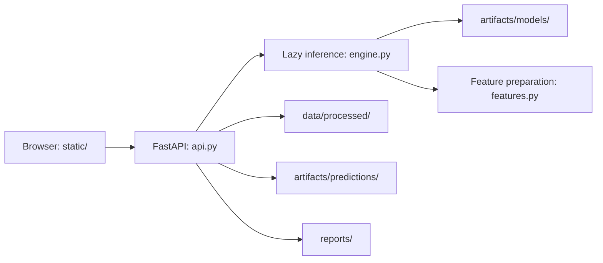

# Architecture and project layout

This repository is an academic machine-learning demo with a FastAPI web application and separate experiment/report commands. The layout separates source code from input data, saved models and generated reports without changing the scientific algorithms.

## Responsibilities

| Location | Responsibility |
| --- | --- |
| `student_performance/api.py` | HTTP routes, input validation, dataset lookup, static assets and downloads. |
| `student_performance/engine.py` | Lazy loading of the web model cache, inference and demo ranking/warning rules. |
| `student_performance/features.py` | Feature constants, ordering and preparation of input dictionaries. |
| `student_performance/models.py` | Scratch regression class used by the web engine and referenced by serialized model objects. |
| `student_performance/paths.py` | The single source of filesystem paths, anchored to this checkout rather than the working directory. |
| `student_performance/cli.py` | Local launcher, available through `python -m student_performance`. |
| `scripts/` | Workflows explicitly invoked with `python -m scripts.<name>`; imports must not generate data, train models or write reports. |
| `tests/` | Discoverable `unittest` suites for API behavior, dataset consistency and structural compatibility. |
| `static/` | The browser interface and locally bundled Chart.js, including its license. |
| `data/raw/` | Input CSV used to construct the dataset. Keep its provenance distinct from generated data. |
| `data/processed/` | Dataset consumed by the experiment scripts and web engine. |
| `artifacts/models/` | Serialized models and scalers used for web inference. |
| `artifacts/predictions/` | Saved prediction comparison CSV used by the validation screen and downloads. |
| `reports/` | Stored experiment metrics, Word report and research plots. |
| `docs/` | Maintainer documentation. |
| `work/` | Ignored local logs and temporary files; not a source of published experiment results. |
| `.pipeline/` | Historical project review metadata, retained for traceability. |

## Request flow

The prediction route obtains the inference engine through `get_engine()`. Importing the application package, engine or API does not train or load models. The validation table reads the saved comparison CSV, not a fresh batch of predictions. Download routes serve existing report and CSV files. Browser URLs such as `/figures/...`, `/download/report` and `/download/compare-csv` remain stable even though the underlying files moved.

## Data and artifact lifecycle

1. `python -m scripts.generate_dataset` reads the raw CSV and produces the processed dataset.
2. `python -m tests.test_dataset` checks its 12 declared consistency rules.
3. `python -m scripts.train_models` evaluates the experiment pipeline and writes plots, a metrics report and prediction comparisons.
4. `python -m scripts.compare_linear_regression` writes the standalone manual-versus-library comparison plot.
5. `python -m scripts.generate_report` builds the Word document from the script's report content and saved plots.
6. The web inference engine separately loads `artifacts/models/trained_models.joblib`. Use `python -m student_performance.engine --retrain` to rebuild its cache deliberately, then restart the server.

Regenerating one artifact does not refresh every other artifact. In particular, running the experiment script does not update the web cache, and the model-summary API still contains stored metrics. A repeatable experiment should deliberately align the processed dataset, web cache, comparison CSV, metrics and report before presenting results.

The existing artifact set is preserved during the structural refactor. Moving files does not constitute retraining or revalidation of the scientific results.

## Compatibility entry points

- Root `app.py` remains a small compatibility entry so `uvicorn app:app` continues to work. New code should target `student_performance.api:app`.
- Root `model_engine.py` keeps the old `model_engine.LinearRegressionScratch` lookup available. Older Joblib/Pickle files contain that module name; removing it could break deserialization even if the new implementation is identical.
- `run_app.py` and `run_app.bat` remain convenient local launchers. The canonical command is `python -m student_performance`; `--port` and `--no-browser` control its local launch behavior.

The compatibility files are intentional adapters, not duplicate implementations. Keep the real logic inside the application package.

## Path and import rules

Import paths from `student_performance.paths` instead of building data/report paths with each module's `__file__` or relying on the shell's current folder. Create output directories in the workflow that writes to them. Keep `__init__.py` files lightweight. Place script execution behind `main()` and an `if __name__ == "__main__"` guard so test discovery and tooling can import modules safely.

Launch module commands from the repository root, or configure Python's import path explicitly when using another working directory. Filesystem paths remain checkout-relative once the package is importable.

## Verification and scientific limits

Run `python -m unittest discover -s tests -v` for the complete available suite. API and structural tests guard operational behavior, including saved-model compatibility; dataset checks verify selected consistency constraints. Passing them is not a full scientific audit of splitting, leakage, calibration or generalization.

Stored regression results currently report OLS R² Test of 0.1900 and Scratch GD R² Test of 0.1365. The current comparison CSV reports 136/146 correct ranks (93.15%) and mean GPA error around 0.166; these are different measurements and should not be conflated. The warning index uses demo heuristics and should not be described as a calibrated dropout probability or an official university decision.
